# 智能旅行助手 —— 代码分析与流程图

> **v2 更新说明（本次审查）**：相比上一版，代码有 3 处改动 ——
> ① `_react_loop` 增加「空响应重试」分支；② 页面改为左右两栏布局；③ 静态资源加版本号防缓存。
> 改动虽小但方向正确，具体分析见文末 **第十二节**。

## 一、项目定位

一个**本地运行**的 Web 应用：输入「所在城市 + 目的地城市 + 出发日期 + 旅行天数」，自动产出一份完整旅行方案 —— 火车票、酒店、天气预报、每日游玩路线、总花销。

技术栈极简：后端 FastAPI（同步路由 + `asyncio.run` 驱动内部异步），前端原生 HTML/JS，无构建步骤。

```
travel-assistant/
├── run.py                    # uvicorn 启动
├── app/
│   ├── main.py               # FastAPI 入口，4 个路由
│   ├── config.py             # .env 读取 + 密钥校验
│   ├── agents/planner.py     # ★ 核心：ReAct 循环 + 工具路由 + 数据规整
│   └── services/
│       ├── deepseek.py       # LLM 调用（chat / chat_with_tools）
│       ├── tuniu.py          # 途牛 MCP 客户端（车次/酒店/门票）
│       ├── weather.py        # wttr.in 天气
│       └── tavily.py         # Tavily 景点搜索
└── static/                   # index.html / app.js / style.css
```

---

## 二、核心架构：ReAct 范式

这个项目最本质的设计决策是：**不在代码里写死「先查什么、再查什么」的流水线，而是把数据源包装成工具交给 LLM，由模型自主决定调用顺序。**

分工非常清晰：

| 角色 | 负责 |
|------|------|
| **LLM（DeepSeek）** | 思考：决定查什么、传什么参数、何时停止 |
| **Python 代码** | 执行：真正发起 HTTP 请求、规整数据、兜底异常 |

代码注释里有一句点题的话：*"改需求只需改这段文字（SYSTEM_PROMPT），不用改执行流程。"*

### 整体架构图

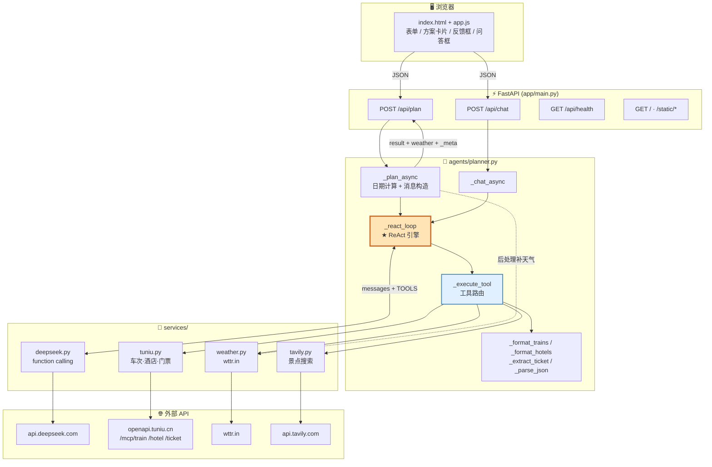

---

## 三、主流程：生成旅行方案（`/api/plan`）

### 3.1 流程说明

**阶段 1 —— 准备（`_plan_async`）**

1. `config.ensure_keys()` 校验三个密钥（TUNIU / DEEPSEEK / TAVILY），缺任何一个直接抛错
2. 日期计算，核心约定：
   - `check_in = 出发日`
   - `hotel_nights = days - 1`（玩 N 天住 N-1 晚）
   - `check_out = 出发日 + max(days-1, 1)`
   - `return_date = 出发日 + (days-1)`（最后一天返程）
3. 构造 user 消息：**只给结构化信息 + 个人需求，不预查任何数据**

**阶段 2 —— ReAct 循环（`_react_loop`）**

这是整个 Agent 的心脏，`max_steps=24` 作为安全阀防止死循环。每一轮：

1. 调模型（带完整 messages + TOOLS 定义）
2. **判断结束**：模型没返回 `tool_calls` → 认为信息够了 → `content` 就是最终答案
3. 把模型的 `tool_calls` 作为 assistant 消息追加回 messages（function calling 协议要求）
4. 逐个执行工具，结果作为 `role="tool"` 消息追加，用 `tool_call_id` 关联
5. 回到第 1 步

**阶段 3 —— 后处理**

循环结束后，Python **再单独查一次天气**。原因很微妙：模型在循环里查天气是为了*规划路线*用，但前端要展示一份准确结构化的天气，所以由代码确定性地补一份。然后附加 `_meta`（含空 `warnings` 数组）返回。

### 3.2 主流程图

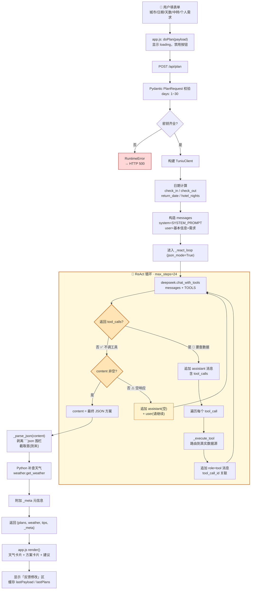

---

## 四、`_execute_tool` —— 工具路由与数据规整

模型只负责"决定调哪个工具、传什么参数"，真正干活的是这个函数。它有**两层关键设计**：

1. **精简数据**（防上下文爆炸）：车次取前 20、酒店前 15、景点前 3
2. **异常兜底**：任何工具失败都不抛异常，而是返回 `{"error": ...}`，让模型看到错误后自行决定——重试、换工具、或说明失败

### 5 个工具的映射与处理

| 工具名 | 数据源 | 规整函数 | 特殊处理 |
|--------|--------|----------|----------|
| `search_trains` | 途牛 `/mcp/train` | `_format_trains` → `_filter_trains_by_station` | 席别英文字段→中文；**过滤下辖县市站点** |
| `search_hotels` | 途牛 `/mcp/hotel` | `_format_hotels` | `prices` 参数按预算过滤 |
| `search_tickets` | 途牛 `/mcp/ticket` | `_extract_ticket` | **缓存 + 过滤非门票票种** |
| `get_weather` | wttr.in | `weather.get_weather` | 只取白天 6:00–20:00 |
| `search_attractions` | Tavily | `_format_attractions` | 截断 500 字符 |

### 三个值得注意的启发式处理

**① `_filter_trains_by_station` —— 过滤下辖县市**

途牛按"苏州"查车次，会返回终点是"张家港""常熟"的车次，这些离苏州市区很远。用「站点名是否以城市名开头」做启发式过滤：

- `苏州 / 苏州北 / 苏州园区` → 以"苏州"开头 → **保留**
- `张家港 / 常熟 / 昆山` → 不以"苏州"开头 → **过滤**
- 若过滤后为空 → **退回原列表**（避免误伤导致无车次可用）

**② `_extract_ticket` —— 过滤伪门票**

途牛可能返回"VIP 讲解服务""夜游演出票""游船票"，价格虚高：

1. 过滤名称含 `讲解/服务/演出/游船/导游/vip` 的票种
2. 优先取"成人票"，取其中**最低价**
3. 若过滤后无真正门票 → 返回 `{"price": None, "note": "免费或暂无门票信息"}`

**③ 门票缓存 `_ticket_cache`**

避免同一景点在 ReAct 循环里被重复查询浪费限流额度。**只有成功拿到价格的才缓存**——限流错误不缓存，下次可重试。

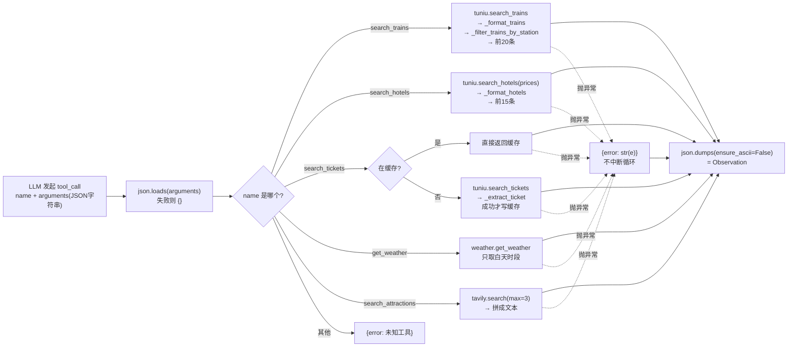

---

## 五、途牛 MCP 客户端（`services/tuniu.py`）

途牛开放平台采用**无状态 JSON-RPC 2.0 over HTTP**，与标准 MCP 不同，**不需要 initialize 握手**，直接 POST `tools/call`。

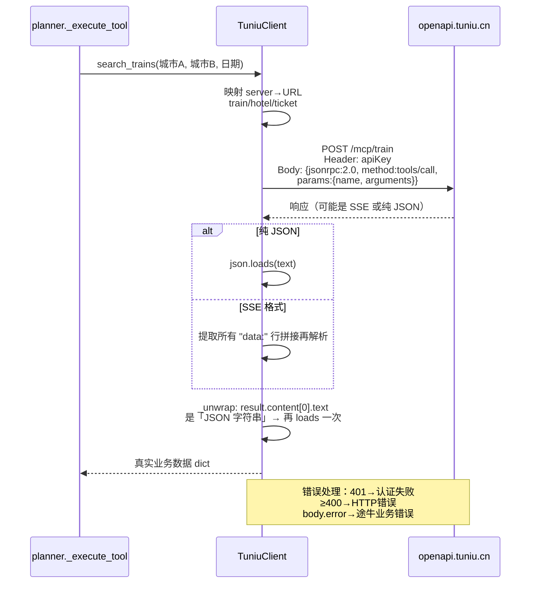

**两个容易踩的坑（代码都已处理）**：

1. **响应是 SSE 格式**（`event: message` + `data: {...}`），不能直接 `resp.json()`，需先提取 `data:` 行 —— `_parse_body`
2. **`tools/call` 返回体嵌套两层**：`result.content[0].text` 是一个"JSON 字符串"，需要再 `json.loads` 一次 —— `_unwrap`

**认证方式也是坑**：用请求头 `apiKey`，而不是常见的 `Authorization`。

---

## 六、自由问答（`/api/chat`）

与 `plan_trip` **共用同一个 ReAct 引擎**（`_react_loop` + `TOOLS`），只换了两样东西：

| | `/api/plan` | `/api/chat` |
|---|---|---|
| System prompt | `SYSTEM_PROMPT`（规划师角色，含大量硬约束） | `CHAT_SYSTEM_PROMPT`（咨询助手） |
| `json_mode` | `True` → 解析成 dict | `False` → 包成 `{"answer": content}` |
| 注入日期 | 用用户给的出发日期 | `今天是 {date.today()}`，便于换算"明天/后天" |

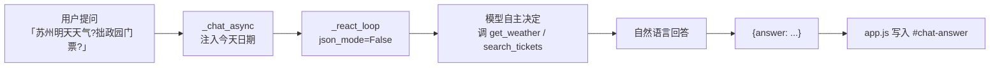

---

## 七、前端交互与反馈迭代

### 反馈修改机制（`feedbackBtn`）

这是前端一个巧妙的设计：用户不满意方案时，**前端把「上一轮方案摘要 + 用户反馈」拼接后追加到 `requirements`**，复用同一个 `/api/plan` 接口重新请求。

```
newRequirements = 原始需求
                + "\n\n【上一轮方案】" + planSummary   // "方案一（总价 1200 元）：理由；..."
                + "\n\n【用户反馈】" + feedback
                + "\n请基于上一轮方案，严格按照上述反馈修改后重新给出方案。"
doPlan({ ...lastPayload, requirements: newRequirements })
```

**为什么要带「上一轮方案摘要」？** 让 DeepSeek 知道要*基于哪套方案来改*，而不是从零重新生成一套完全不同的方案。这是纯 prompt 层面的迭代控制，后端无需任何会话状态。

### 前端状态流转

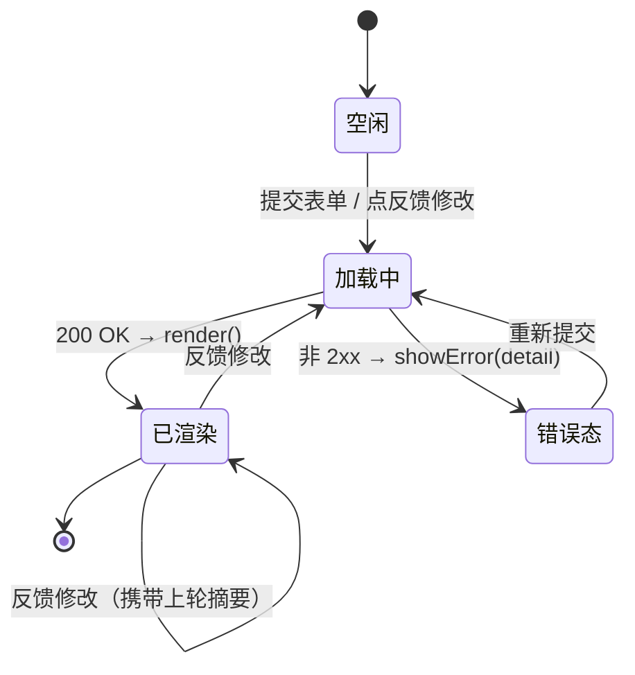

### 前端渲染结构

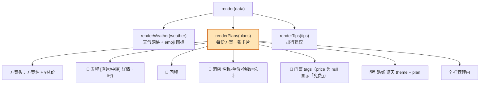

**XSS 防护**：所有后端数据经 `esc()` 转义（`& < > " '`）后才拼进模板字符串。这是必要的——方案内容全部来自 LLM 生成，属于不可信数据。

---

## 八、SYSTEM_PROMPT 中的硬约束

ReAct 架构下，**所有业务规则都写在 prompt 里而不是代码里**。这是与该架构匹配的设计，但也是风险的集中点。当前 prompt 中的硬约束：

| 约束 | 说明 |
|------|------|
| 用户需求是硬约束 | 不得为省钱/省时而牺牲用户要求 |
| 价格真实 | 车次/酒店/门票价格必须来自工具返回，不得虚构 |
| 终点站校验 | 目的地是「苏州」时，张家港/常熟/昆山不可作终点 |
| 中转衔接 | 第二段发车 > 第一段到达 + 换乘时间，禁止时间倒挂 |
| 出发时段 | 用户指定"9点左右"时，凌晨 0-6 点、深夜 22-24 点车次绝对禁止 |
| 门票限流 | 只查 3-4 个关键景点；限流时用 Tavily 文本价格并在 reason 注明"参考价" |
| 输出格式 | 纯 JSON，无 Markdown，`{"plans":[...], "tips":"..."}` |
| 总价公式 | `total_cost = 去程 + 回程 + hotel.total + Σ门票` |

---

## 九、代码质量观察

### 做得好的地方

1. **注释密度极高且解释"为什么"**——例如为什么天气要查两次、为什么要退回首列表、为什么缓存只存成功结果，这些决策上下文都保留下来了
2. **错误隔离到位**——工具层任何异常都转成 `{"error":...}` 交给模型，而不是让整个循环崩溃；`_parse_json` 兼容模型"JSON 前夹杂推理文本"的情况
3. **防上下文爆炸**——每一层都有条数/字符数截断（车次 20、酒店 15、景点 3、Tavily 500 字符）
4. **前端零构建**——原生 JS，`esc()` 统一转义，`lastPayload` 复用实现多轮迭代
5. **防死循环**——`max_steps=24` 安全阀

### 潜在问题与改进建议

| 问题 | 位置 | 说明 | 建议 |
|------|------|------|------|
| **同步阻塞** | `main.py` 路由 | 同步 `def` + 内部 `asyncio.run`，FastAPI 会丢到线程池；但单次请求可能跑 24 轮 LLM 调用（每轮 timeout 90s），极端情况请求耗时数分钟 | 改 `async def` + 直接 `await`；或加 SSE 流式返回进度 |
| **无超时预算** | `_react_loop` | 只有步数上限，没有**总时长**上限。24 步 × 90s 最坏 36 分钟 | 加 `asyncio.timeout()` 总预算（如 180s） |
| **工具串行执行** | `_react_loop` 第 4 步 | 模型一次返回多个 `tool_calls` 时串行执行，而它们通常互相独立 | 用 `asyncio.gather` 并行 |
| **全局可变缓存** | `_ticket_cache` | 模块级 dict，无上限、无 TTL，多 worker 下不共享且会无限增长 | 加 LRU + TTL，或换 `functools.lru_cache` |
| **`warnings` 恒为空** | `_plan_async` | `_meta.warnings` 初始化为 `[]` 但从未写入；README 提到的"3 天以上天气缺失"等已知限制没有真正变成 warning | 在补天气时检测 `len(weather) < days` 并写入警告 |
| **硬约束全靠 prompt** | `SYSTEM_PROMPT` | "票价不虚构""禁止时间倒挂""凌晨车次禁止"等规则无代码兜底，模型可能不遵守 | 关键约束做**后置校验**：代码检查去程发车时段、中转时序、总价公式，不符则重试或标记 |
| **`_parse_json` 兜底较脆** | `planner.py:562` | "首 `{` 到末 `}`"截取法在嵌套/多 JSON 场景可能出错；且未校验必需字段 | 截取后用 Pydantic model 校验结构，缺失字段给默认值 |
| **`days=1` 边界** | `_plan_async:229-231` | `days=1` 时 `hotel_nights=0` 但 `check_out = 出发日+1`，酒店查询"住 0 晚"语义矛盾 | 明确：1 天行程是否给酒店；否则 `check_out` 应为 `check_in` |
| **HTTP 明文天气** | `weather.py:10` | 用 `http://wttr.in`（注释说 HTTPS 会 SSL 失败）；数据不敏感，但存在中间人篡改天气的可能 | 试 `https` 带证书校验，或换正规天气 API |
| **密钥缺失即全局失败** | `config.ensure_keys()` | TAVILY 缺失时整个 `/api/plan` 不可用，即使不用景点搜索 | 按需校验：只在真正调用 Tavily 时报错 |
| **无请求去重/缓存** | `/api/plan` | 相同参数重复提交会重新跑完整 ReAct 循环（烧 token） | 按 payload hash 做短期缓存 |
| **无测试** | 全项目 | 无任何测试文件；`_filter_trains_by_station`、`_extract_ticket`、`_parse_json` 都是纯函数，很好测 | 补 pytest 单测覆盖这些纯函数 |
| **`.env.example` 编码** | 根目录 | PowerShell 读出来是乱码（GBK/UTF-8 混用），首行注释与 `TUNIU_API_KEY` 粘连 | 统一存为 UTF-8 |

---

## 十、端到端总览

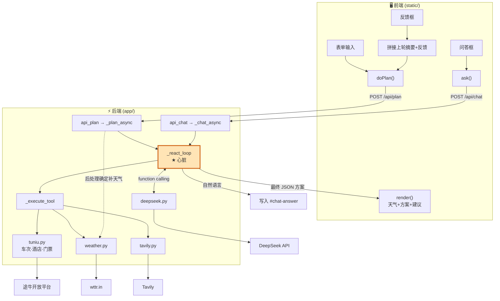

---

## 十一、一句话总结

**这是一个用 ReAct 范式实现的旅行规划 Agent：把 4 个外部数据源（途牛车次/酒店/门票、wttr.in 天气、Tavily 景点）包装成 5 个 function calling 工具，让 DeepSeek 自主决定查询顺序，代码只负责执行与规整。**

架构上最值得肯定的是**关注点分离干净**——模型思考、代码执行、prompt 承载业务规则；最需要补强的是**关键约束缺少代码层校验**（全靠 prompt 自觉），以及**缺少总时长预算控制**。

---

## 十二、v2 变更审查

本次对比上一版，共发现 **3 处改动**（按影响排序）：

| # | 文件 | 改动 | 评价 |
|---|------|------|------|
| 1 | `app/agents/planner.py:348-357` | ReAct 循环增加「空响应重试」分支 | ✅ 修掉一个真实缺陷 |
| 2 | `static/index.html` + `style.css` | 单列 → 左右两栏布局 | ✅ 交互改善 |
| 3 | `static/index.html:7,83` | 静态资源加 `?v=2` / `?v=3` | ✅ 防缓存，但版本号不一致 |

### 12.1 核心改动：空响应重试（`_react_loop`）

```python
if not tool_calls:
    content = message.get("content") or ""
    # 模型偶尔会返回「空内容且不调工具」的异常状态（比如还在思考却被截断），
    # 这时不能当作最终答案，而是追加一句提示让模型继续，回到循环重试。
    if not content.strip():
        messages.append({"role": "assistant", "content": message.get("content")})
        messages.append({"role": "user", "content": "请继续，直接输出你的最终回答。"})
        continue
    if json_mode:
        return _parse_json(content)
    return {"answer": content}
```

**这修掉的是一个真实且严重的缺陷。** 改动前的逻辑是：

```python
if not tool_calls:
    content = message.get("content") or ""      # 空字符串
    if json_mode:
        return _parse_json("")                  # → 抛 RuntimeError
    return {"answer": ""}                       # → 前端显示空白
```

旧代码把「模型没调工具」直接等同于「模型给出最终答案」，但这两者并不等价。当 DeepSeek 因为**推理过程被 max_tokens 截断**、或返回了纯 `reasoning_content` 而 `content` 为空时，旧代码会：

- `json_mode=True` → `_parse_json("")` 两个分支都失败 → `RuntimeError: DeepSeek 输出不是合法 JSON` → HTTP 500，**用户白等几分钟得到一句报错**
- `json_mode=False` → 返回 `{"answer": ""}` → 前端显示空白答案

新代码把这条路改成了「**追加消息 + continue 重试**」，这是对的：空响应是*可恢复*的瞬时状态，不该当成终态。

**一个细节做得很好**：重试时先 append 了 `{"role":"assistant","content": message.get("content")}`（即那条空消息本身），保持了对话历史的完整性，再追加 user 提示。这符合 OpenAI 兼容协议对消息序列的要求。

**但有两处需要注意**：

**① `content` 可能是 `None` 而非空字符串。** 代码用 `message.get("content") or ""` 取内容做判断，但 append 时用的是**原始的** `message.get("content")`。若模型返回的 `content` 是 `None`，追加进历史的就是 `{"role":"assistant","content":null}`。多数 OpenAI 兼容服务能接受这种写法（等同空消息），但严格校验的网关可能报 400。稳妥做法是统一写 `content or ""`。

**② 空响应重试与工具调用共享同一个 `max_steps` 预算**（详见下方流程图）。如果模型陷入「持续返回空 content」的状态（例如某个 prompt 让它反复截断），旧代码会在第 1 步就失败退出，新代码则会**空转满 24 次 LLM 调用**才抛错。

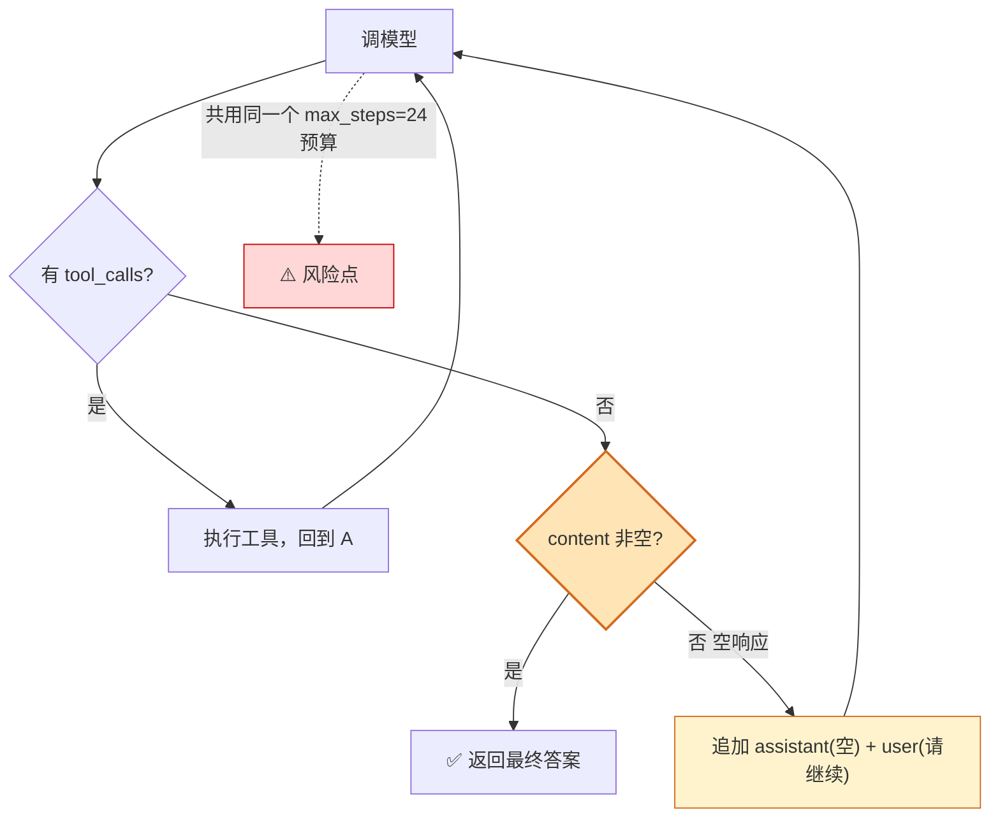

按每次 DeepSeek 调用几秒到几十秒估算，一次失败请求可能占用数分钟。虽然比「直接报错」对用户更友好（模型多半第二次就正常了），但**建议给空响应单独设一个更小的重试上限**（比如 2~3 次），避免极端情况下把 24 步全烧在空转上：

```python
empty_retries = 0
...
    if not content.strip():
        empty_retries += 1
        if empty_retries > 3:
            raise RuntimeError("DeepSeek 连续多次返回空响应")
        ...
        continue
```

### 12.2 布局改动：单列 → 左右两栏

```css
.layout {
  display: grid;
  grid-template-columns: 440px minmax(0, 1fr);  /* 左固定 440px，右自适应 */
  gap: 20px;
  align-items: start;
}
/* 窄屏退化为单列 */
@media (max-width: 900px) {
  .layout { grid-template-columns: 1fr; }
}
```

配套的 HTML 结构变化：

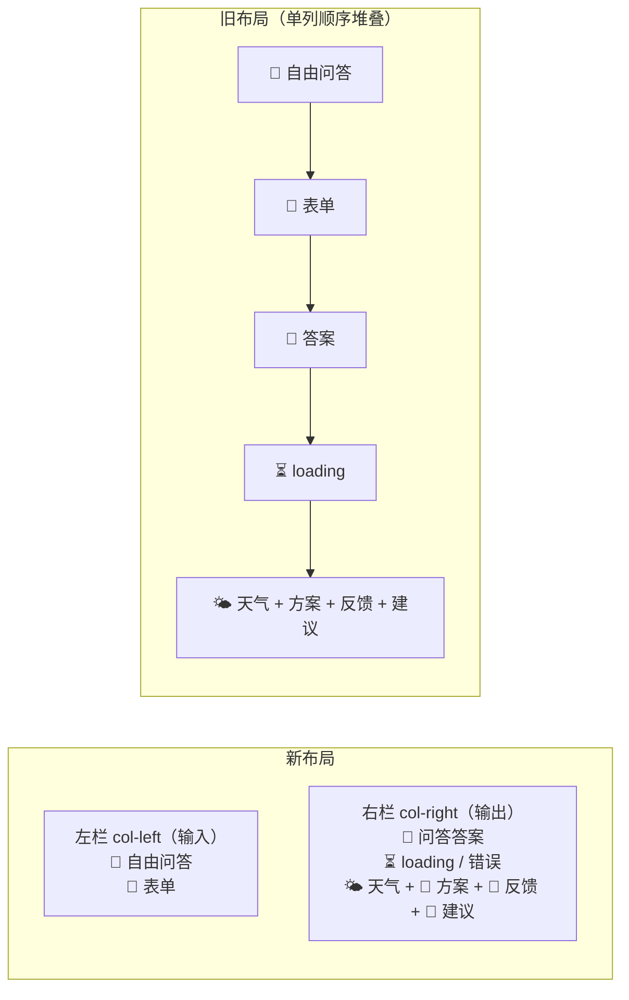

**这个改动解决了旧布局一个实际问题**：旧版把「自由问答框」放在最顶部，用户点「提问」后答案 `#chat-answer` 出现在**页面中段**（问答框下方、表单上方），而长长的方案结果又在更下面——用户提问后往往看不到答案，需要滚动寻找。

新版把输入全部归到左栏、输出全部归到右栏，**问答答案移到右栏顶部**，视觉上"提问→看答案"的距离大幅缩短。`minmax(0, 1fr)` 的写法也正确——避免 grid 子项被内容撑破。

另外注意到一个配套修正：左栏里表单强制单列 `grid-template-columns: 1fr`，因为 440px 宽度下再分两列会让输入框过于拥挤。这个细节考虑到了。

**小建议**：`440px` 是硬编码的固定宽度。在 900~1100px 之间的窗口（比如小笔记本分屏），左栏占比会显得偏大。可考虑 `grid-template-columns: minmax(340px, 400px) minmax(0, 1fr)` 或改用 `clamp()`。

### 12.3 静态资源版本号

```html
<link rel="stylesheet" href="/static/style.css?v=3" />
<script src="/static/app.js?v=2"></script>
```

加 `?v=` 参数是对的——浏览器会把它当作不同的 URL，从而绕过缓存。这解决了「改了 CSS 但用户看到旧样式」的经典问题。

**但版本号是手工维护的，且当前两个文件不一致**（css 是 `v=3`，js 是 `v=2`）。手工版本号的问题是：**下次改文件时很容易忘记递增**，退化回缓存问题。

两个改进方向（任选）：

1. **零成本**：每次改完静态文件，把两个版本号统一 +1（至少保持一致，便于心算）
2. **更彻底**：由后端注入内容哈希。例如在 `main.py` 里读文件计算 md5 前 8 位，通过模板变量注入 index.html —— 这样永远不会忘

考虑到这是个本地小工具，方案 1 足够了。

### 12.4 未改动的部分

以下上一版指出的问题**本次均未处理**，仍然存在：

| 问题 | 状态 |
|------|------|
| 路由同步阻塞（`def` + `asyncio.run`） | ❌ 未改 |
| 无总时长预算（只限步数不限时间） | ❌ 未改（且因空响应重试，风险略增） |
| 工具串行执行（可并行） | ❌ 未改 |
| `_ticket_cache` 无上限无 TTL | ❌ 未改 |
| `_meta.warnings` 恒为空数组 | ❌ 未改 |
| 硬约束全靠 prompt，无代码校验 | ❌ 未改 |
| `_parse_json` 无结构校验 | ❌ 未改 |
| `days=1` 时「住 0 晚」语义矛盾 | ❌ 未改 |
| `config.ensure_keys()` 全局校验（TAVILY 缺失即全废） | ❌ 未改 |
| 无测试 | ❌ 未改 |
| `.env.example` 编码混合 | ❌ 未改 |

### 12.5 变更后建议的优先级

按「投入产出比」排序：

1. **🔴 给空响应重试设独立上限**（本次改动引入的新隐患，改动量 ~3 行）
2. **🔴 加总时长预算** `async with asyncio.timeout(180)`（改动量 ~2 行，防用户等 30 分钟）
3. **🟡 统一静态资源版本号约定**（避免下次忘记递增）
4. **🟡 关键约束后置校验**（去程时段 / 中转时序 / 总价公式——prompt 约束不可靠）
5. **🟢 补纯函数单测**（`_filter_trains_by_station` / `_extract_ticket` / `_parse_json` 都极易测）
6. **🟢 工具并行执行** `asyncio.gather`（多 tool_calls 时明显提速）

### 12.6 本次审查小结

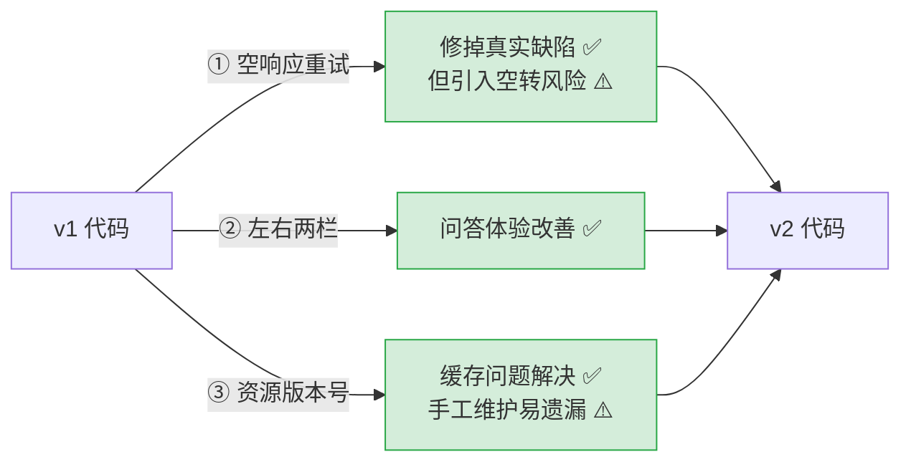

**总评**：三个改动方向都正确，尤其第 1 项修掉了一个会导致 HTTP 500 的真实缺陷，含金量最高。但改动集中在"体验层"，**上一版指出的架构层问题（无时间预算、约束无代码校验）一个都没动** —— 这些才是这个 Agent 在生产环境最容易出问题的地方。建议下一轮优先补 1、2、4 三项。
